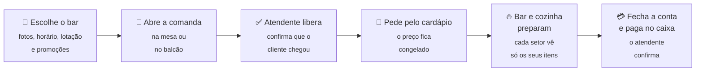
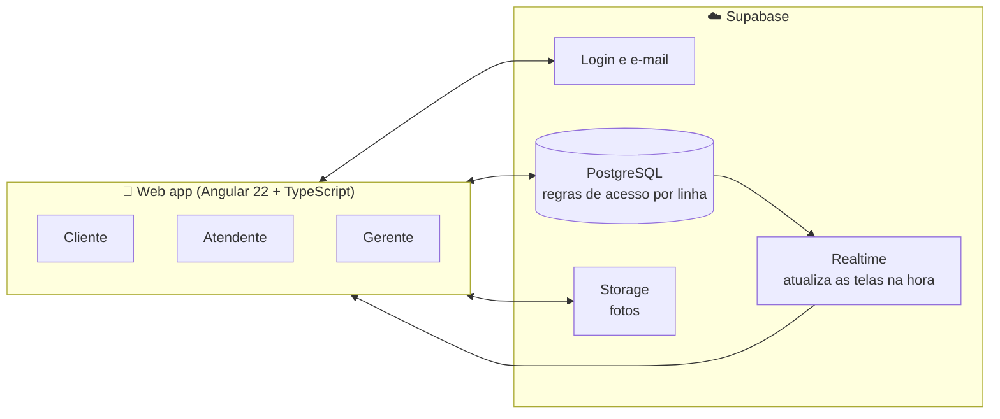

<!-- Banner: salvar em .github/assets/banner.png e descomentar

-->

# +party

### Sua noite, sem complicação.

**Comanda digital para bares:** escolher o bar, pedir e fechar a conta pelo celular, direto no navegador. 
Menos fila no balcão, nada de papel e nenhum aplicativo para baixar.

  
  

  
  
  
  
  

Startup Project One · Análise e Desenvolvimento de Sistemas · Facens · equipe TechnoMind

---

<!-- Imagem de destaque: uma tela de cada acesso (cliente no celular, atendente e gerente no desktop),
     salvar em .github/assets/tres-acessos.png e descomentar

-->

## 🍻 A dor

Sexta-feira, 23h, bar lotado. **Tudo trava no balcão.**

<table>
  <tr>
    <th width="50%">Quem está no bar</th>
    <th width="50%">Quem administra o bar</th>
  </tr>
  <tr>
    <td>
      🕒 Perde tempo de lazer na fila, <b>para pedir e para fechar a conta</b>  
      🤷 Sai de casa sem saber se o bar está aberto, cheio ou com promoção  
      📵 Não quer baixar mais um aplicativo só para consumir
    </td>
    <td>
      📝 Comanda de papel se perde e gera divergência no caixa  
      🔀 Pedidos se embolam entre bar e cozinha  
      📉 Sem dados da noite e sem um jeito simples de divulgar promoções
    </td>
  </tr>
</table>

## 💡 A ideia

> **Escolher o bar, pedir e fechar a conta pelo celular, direto no navegador.**
> O cliente ganha tempo e a conta clara na tela. O bar ganha o controle da noite em tempo real.

O +party une as duas pontas da noite: a **descoberta**, antes de sair de casa, e a **operação**, dentro do bar. Tudo num web app que abre no navegador do celular e do computador, sem maquininha própria, sem cartão de recarga e sem taxa por transação.

## 👥 Um login, três acessos

Todo mundo entra pela mesma tela. O app reconhece quem é e leva cada um para a sua área.

<table>
  <tr>
    <th width="33%">🍹 Cliente</th>
    <th width="33%">🧑‍🍳 Atendente</th>
    <th width="33%">📊 Gerente</th>
  </tr>
  <tr valign="top">
    <td>
      Descobre bares por filtro ou no mapa, vê a agenda e as avaliações, abre a comanda na mesa ou no balcão, pede pelo cardápio e acompanha cada item até ficar pronto.
    </td>
    <td>
      Libera quem chegou, vê os pedidos separados entre <b>bar</b> e <b>cozinha</b>, avisa quando ficam prontos e confirma o pagamento no caixa.
    </td>
    <td>
      Acompanha o movimento ao vivo e os resultados por período, publica promoções e eventos, responde avaliações e monta a equipe.
    </td>
  </tr>
</table>

## 🌙 A noite em seis passos

1. **Escolhe o bar.** Fotos, horário, lotação, promoções e agenda, mesmo sem login.
2. **Abre a comanda.** Na mesa ou no balcão. A comanda é da pessoa, não da mesa: cada amigo tem a sua.
3. **O atendente libera.** Ele confirma que o cliente está mesmo no bar. Antes disso, nada de pedido.
4. **Pede pelo cardápio.** O preço fica congelado no momento do pedido.
5. **Bar e cozinha preparam.** Cada setor vê só os seus itens, e o cliente é avisado quando fica pronto.
6. **Fecha a conta e paga.** O pagamento é no caixa do bar; o atendente confirma e a comanda fecha.

<!-- Jornada do cliente em prints de celular (Descobrir, perfil do bar, comanda),
     salvar em .github/assets/jornada.png e descomentar

-->

## ✨ O que já funciona

<b>🍹 Para quem sai à noite</b>

- **Descobrir:** filtros *Aberto agora*, *Evento hoje* e *Quente agora*, lista ou mapa, e a nota de quem já foi ("★ 4,6 · 128 avaliações").
- **Perfil do bar:** fotos, horário, *Como chegar*, Instagram e WhatsApp, além das abas Cardápio, Agenda, Novidades e Avaliações.
- **Novidades:** promoções e eventos dos bares numa lista simples.
- **Comanda digital:** em mesa ou balcão, com a conta sempre clara na tela.
- **Fila da mesa:** se a mesa está sendo liberada, o cliente entra na fila. Quando ela libera, a comanda abre sozinha e chega o aviso *"Sua mesa liberou!"*.
- **Agenda:** "Tenho interesse" nos eventos, com lembrete 2 horas antes.
- **Avaliação verificada:** só avalia quem pagou uma comanda naquele bar.
- **Notificações na hora:** comanda liberada, pedido pronto e pagamento confirmado.

<b>🧑‍🍳 Para quem atende</b>

- **Pedidos separados por setor:** bar e cozinha, cada um no seu ritmo (*novo → em preparo → pronto*).
- **Três cartões que dizem o que fazer agora:** *Liberar*, *Receber* e *Abertas*, com destaque para quem espera há muito tempo.
- **Aviso de histórico:** a equipe é avisada se o cliente já saiu sem pagar antes.
- **Ajuste de mesa:** troca de mesa na hora de liberar, e "Nesta mesa agora" para ver quem divide a mesa.

<b>📊 Para quem administra</b>

- **Movimento ao vivo:** faturamento, comandas, ticket médio e *"Precisa de atenção"*, com conta sem pagamento, pedido parado, cliente esperando e avaliação baixa.
- **Resultados por período:** 3, 7, 15 ou 30 dias, comparados com o período anterior, com mais vendidos, horários de pico, clientes que voltaram e itens que não vendem.
- **Postagens no estilo Instagram:** promoções, eventos e novidades, que chegam como notificação para quem já foi ao bar.
- **Agenda de eventos:** únicos ou semanais, com a contagem de interessados.
- **Avaliações:** média, distribuição, resposta pública e denúncia.
- **Equipe por convite:** link de convite com validade, aprovação do gerente e desempenho de cada atendente.
- **Divulgar meu bar:** imagem pronta para o Story do Instagram, link para a bio e textos para o WhatsApp.

## 🔐 Seguro de verdade, não só na tela

A segurança do +party mora **no banco de dados**, não apenas na interface. Mesmo quem tentar chamar a API diretamente esbarra nas mesmas regras:

- 🙋 **Cada um vê só o que é seu.** O cliente vê as próprias comandas; a equipe vê só o bar em que trabalha.
- 🚫 **Ninguém trapaceia a conta.** O cliente não libera a própria comanda, não a marca como paga e não muda o preço do que pede.
- 👔 **Ninguém se promove sozinho.** Todo mundo nasce cliente, e só o gerente contrata, por convite.
- 🛡️ **Uma comanda ativa por pessoa.** Quem tem conta sem pagar não abre outra até acertar.
- 🍪 **Sem rastreamento.** O app não usa cookies nem anúncios, e a Política de Privacidade e os Termos de Uso ficam abertos dentro do app.

## 🎯 Para quem é

| | 🍻 O frequentador (B2C) | 🏪 O bar (B2B) |
|---|---|---|
| **Quem** | 19 a 25 anos, universitário ou no primeiro emprego, sai à noite em Sorocaba | Bar ou pub com pico de movimento |
| **O que quer** | Achar o rolê e a promoção certa, e pedir sem esperar o garçom | Organizar bar e cozinha, fechar o caixa sem divergência e atrair público |
| **Como usa** | De graça, pelo navegador | Assinatura mensal |

### O mercado

| 🇧🇷 Brasil | São Paulo | 🎶 Sorocaba | 🚀 1º ano |
|:---:|:---:|:---:|:---:|
| **589.348** bares e restaurantes ativos | **154.259** estabelecimentos no estado | **344** bares com entretenimento | **10 bares** cerca de 2,9% do nicho local |

Fonte: dados abertos de CNPJ da Receita Federal, CNAE 5611-2, agosto de 2026.

### Quem resolve um lado não resolve o outro

| O que o bar e o cliente precisam | Zig | Goomer | Guias locais | **+party** |
|---|:---:|:---:|:---:|:---:|
| Descobrir o bar antes de sair | ❌ | ❌ | ✅ | ✅ |
| Comanda e pedido pelo celular | ✅ | só cardápio QR | ❌ | ✅ |
| Sem recarga nem taxa por transação | ❌ | ✅ | — | ✅ |
| Sem baixar aplicativo | — | ✅ | — | ✅ |

Benchmark da equipe, setembro de 2026.

### Modelo de negócio

- **Receita:** assinatura mensal do bar (cerca de **R$ 299**) e destaque pago nas Novidades.
- **Canais:** visita aos bares, landing page e a própria vitrine de Novidades.
- **Métricas que importam:** bares ativos, comandas por noite, ticket médio e tempo de preparo.

## 🧪 Validado com quem usa

Testamos o protótipo no bar **Japa's Deck**, em Sorocaba, em 3 de setembro de 2026, com dois frequentadores e um gerente de bebidas. O que ouvimos virou produto:

| O que ouvimos | O que fizemos |
|---|---|
| *"Quero saber onde tem rolê e promoção"* | Criamos a vitrine de promoções e eventos, hoje **Novidades** |
| *"A letra está difícil de ler"* | Mais contraste e tipografia maior |
| *"O painel do gerente está carregado"* | Painel focado em alertas e no resumo da noite |
| *"Preciso confiar no fechamento do caixa"* | Só o atendente confirma o pagamento |

## 🛠️ Como construímos

| Camada | Tecnologia |
|---|---|
| Interface | **Angular 22** e **TypeScript**, mobile-first, abre no celular e no computador |
| Banco e tempo real | **Supabase** com **PostgreSQL**: o pedido chega na hora ao bar e à cozinha |
| Regras de negócio | No próprio banco: regras de acesso por linha (RLS), *triggers* e funções |
| Qualidade | Testes automatizados com **Vitest**, revisão em *pull requests* e análise de segurança e desempenho no Supabase |
| Produto | Lean Startup, Figma, Trello e Scrum |

Quer ver por dentro? Os scripts do banco e o que cada um faz estão em [`supabase/README.md`](supabase/README.md).

## 🚀 Próximos passos

- 🤖 **Chatbot com IA:** tira dúvidas sobre o bar, ajuda no cardápio e recomenda promoções.
- 📱 **App nativo:** notificações mesmo com o app fechado e acesso aos recursos do celular.
- 🍻 **Bares-piloto em Sorocaba:** rumo à meta de 10 bares no primeiro ano.

## 👋 Quem somos

Sete pessoas do 4º semestre de **Análise e Desenvolvimento de Sistemas** da **Facens**, sob orientação do **Prof. Renato do Nascimento Júnior**.

| | Integrante | Papel |
|:---:|---|---|
|  | **Pedro Lima** | Scrum Master e desenvolvedor full-stack |
|  | **Nathan da Silva** | Back-end, banco de dados e versionamento |
|  | **Gabriel Marques** | Front-end e integração |
|  | **Luiz Eduardo** | Requisitos, modelagem e documentação |
|  | **Danilo Bossolani** | BI, marketing e validação de mercado |
| 🎨 | **Kauã David** | UI/UX e identidade visual |
| 🎨 | **Sabrina Montosa** | UI/UX e design de apresentação |

### Quer ver o +party funcionando?

<a href="https://plusparty-landingpage.pedrocardosolima20.workers.dev/"><b>🌐 Site oficial</b></a> · <a href="https://www.youtube.com/@PlusParty-c3y"><b>▶️ YouTube</b></a>

 

Distribuído sob a licença MIT · +party 2026 · Sua noite, sem complicação.

